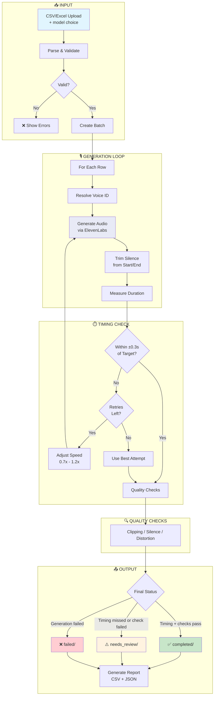

# Voiceover Generation Workflow

## Visual Flowchart



## Step-by-Step Breakdown

### 1️⃣ Input Processing
| Step | Description |
|------|-------------|
| Upload | User picks an ElevenLabs model and submits a CSV/Excel file |
| Parse | Extract script_text, target_duration, voice_id, etc. |
| Validate | Check required columns, data types, value ranges |

### 2️⃣ Audio Generation
| Step | Description |
|------|-------------|
| Resolve Voice | Look up voice ID from name if needed |
| Generate | Call ElevenLabs API with script + voice settings |
| Trim Silence | Remove leading/trailing silence (keep 75ms padding) |
| Measure | Get actual duration of trimmed audio |

### 3️⃣ Timing Adjustment Loop
| Step | Description |
|------|-------------|
| Check | Is duration within ±0.3s of target? |
| Adjust | Calculate new speed (0.7x - 1.2x range) |
| Retry | Regenerate with the adjusted speed setting |
| Max 5 | Up to 5 attempts, keeps best result |

Timing is controlled only through ElevenLabs' `speed` voice setting. The app
never adds `[slower]`/`[faster]` tags itself, because combining tags with the
speed setting compounds and makes delivery too fast or too slow.

### 4️⃣ Quality Checks
| Check | Tool | What It Does |
|-------|------|--------------|
| Audio checks | PyDub | Clipping, silence ratio, distortion (ZCR) |

### 5️⃣ Output Organization
| Folder | Condition |
|--------|-----------|
| `completed/` | Timing within tolerance and all checks passed |
| `needs_review/` | Timing not achieved after max retries, or a check flagged an issue |
| `failed/` | Generation failed completely |

---

## Models

| Model | ID | Notes |
|-------|----|-------|
| V2 Multilingual | `eleven_multilingual_v2` | Default. Most stable and predictable. |
| V3 | `eleven_v3` | Expressive, audio tags. Stability snaps to 0.0 / 0.5 / 1.0. |
| V4 | `eleven_v4` | Newest. Audio tags, 90+ languages, full 0.0-1.0 stability range. |
| Turbo V2.5 | `eleven_turbo_v2_5` | Fastest generation. |

## Audio Tags (V3 and V4)

Write tags directly into `script_text` in your CSV. Examples:

| Category | Tags |
|----------|------|
| **Emotion** | `[excited]` `[happy]` `[sad]` `[calm]` `[warm]` |
| **Delivery** | `[whispers]` `[laughs]` `[sighs]` |
| **Pauses (V4)** | `[pause]` `[long pause]` |

V4 does not support SSML `<break>` tags; use `[pause]` instead. V2 and
Turbo V2.5 don't support audio tags, so leave them out for those models.

---

## Example Flow

```
Input: "Call 1-800-555-1234 today!" (target: 5.0s)
                    ↓
        Generate at speed 1.0x
                    ↓
        Result: 4.2s (too short)
                    ↓
        Adjust: speed = 1.0 × (4.2/5.0) = 0.84x
                    ↓
        Retry at 0.84x
                    ↓
        Result: 4.9s ✓ (within tolerance)
                    ↓
        Run quality checks ✓
                    ↓
        Save to completed/
```
